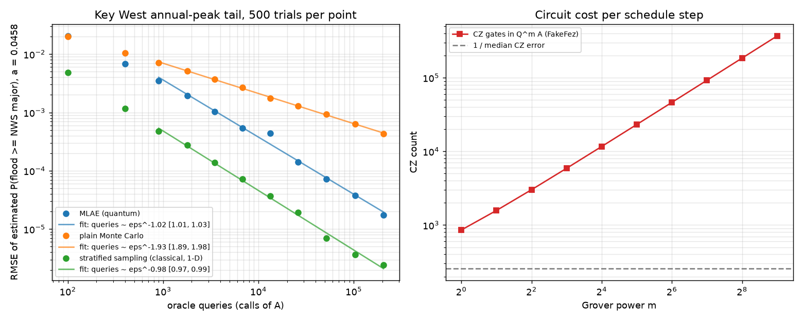

# Floodline: Key West Flood Tail Probability with Quantum Amplitude Estimation

FGCU Quantum Hackathon 2026 candidate build. Self-contained, simulator-only
(`RUN_ON_HARDWARE = False` in `experiment.py`).

## Why this genre

Most of this week's builds compared one heuristic (QAOA, a QML model) with another,
and a classical control that had the same structural prior usually tied. This build
tests a claim that has a proof behind it instead: amplitude estimation (QAE) estimates
a probability to error ε with O(1/ε) oracle queries, while plain Monte Carlo needs
O(1/ε²) samples. The questions are whether the scaling actually shows up when we
measure it on a real problem, and what it costs to get it.

## The problem and the real data

**Question:** in a given year, at today's sea level, what is the probability that Key
West's annual peak water level reaches NWS **major flood** stage?

- **Water levels:** NOAA CO-OPS station 8724580 (Key West, FL), `monthly_mean` product,
  `Highest` column, datum MHHW, metric, 1913-2025. This is one of the longest tide-gauge
  records in the US. It is fetched from `api.tidesandcurrents.noaa.gov` and cached in
  `data/keywest_monthly.csv`.
- **Threshold:** NOAA's published flood levels for the station (`floodlevels.json`).
  NWS major = 2.581 m above station datum. MHHW is 1.941 m above station datum
  (`datums.json`), so the threshold is **0.640 m above MHHW**.
- **Processing** (`flood.py`): annual maxima for years with at least 10 months of data
  (110 years). Each year's maximum is shifted to 2025 sea level using the linear trend
  in annual mean sea level, which is 2.65 mm/yr. A GEV is fitted by maximum likelihood
  (shape c = -0.218, loc = 0.382 m, scale = 0.059 m).
- **Loaded distribution:** the GEV binned onto 2^5 = 32 bins of 4 cm from -0.12 m to
  1.16 m. Tail mass is folded into the end bins, so P(bin ≥ 19) equals the GEV survival
  probability at 0.64 m exactly.
- **Target:** a = **0.04582** (about a 1-in-22-year event). Sanity check: 5 of the 110
  detrended years reached the threshold (4.5%). The five years were 1944, 1965 (Betsy),
  2005 (Wilma), 2017 (Irma) and 2022 (Ian).

Both the quantum and the classical estimators target this same `a`. The comparison is
about how fast each one converges. Whether the GEV is the right flood model is a
separate question that this build does not answer.

## Method

**Circuit** (`qae.py`, 10 logical qubits):
- `A` loads the 32-bin distribution on 5 qubits (`StatePreparation`).
- An `IntegerComparatorGate` flips an objective qubit when bin ≥ 19. It uses 4 idle
  qubits as clean ancillas, which cuts the comparator from about 1040 CZ (no ancillas)
  to about 44 CZ.
- `Q = A S0 A† S_χ` is built with `grover_operator`. P(objective = 1) after `Q^m A` is
  sin²((2m+1)θ), where a = sin²θ. The smoke test checks this against the circuit to
  1e-14, and against `StatevectorSampler` shot sampling.

**Quantum estimator:** maximum-likelihood amplitude estimation (MLAE; Suzuki et al.,
2020). It runs `Q^m A` for m ∈ {0, 1, 2, 4, …, 2^(K-2)} with 100 shots each and
maximizes the joint binomial likelihood. Unlike canonical QAE it needs no QPE and no
controlled-Q. K runs from 1 to 11, so the largest Grover power is m = 512.

**Query accounting:** one call of `A` or `A†` counts as one query, which is the same unit
as one classical draw. A shot of `Q^m A` costs 2m+1 queries. The simulator speed-up is
to compute P(obj = 1) for each m once, by exact statevector evolution of the circuit's
own unitary, and then draw binomial shots. This is mathematically identical to running
the sampler; the smoke test checks it against `StatevectorSampler`.

**Classical arms**, run at exactly the same query budgets:
1. **Plain Monte Carlo:** N iid draws from the binned GEV, counting exceedances. This is
   exactly Binomial(N, a); the smoke test checks it against real draws.
2. **Stratified sampling (1-D):** one uniform draw in each of N strata of [0, 1], passed
   through the binned inverse CDF. This is the "same structural prior" control. In one
   dimension it also reaches O(1/N).

**Measurement discipline:**
- 500 seeded trials per (arm, budget). Error is RMSE against `a`.
- The scaling exponent comes from an OLS fit of log RMSE on log queries for K ≥ 3. The
  95% CI comes from 2000 bootstrap resamples of trials. We report α in
  queries ∝ ε^(-α), where α = -1/slope.
- Queries needed at matched ε targets are read off each bootstrap fit, with the CI of
  the paired ratio.

## Results (`results.json`, `results.png`)



**Fitted scaling exponent α (queries ∝ ε^-α), 95% bootstrap CI:**

| arm | α | 95% CI | textbook |
|---|---|---|---|
| MLAE (quantum) | **1.02** | [1.01, 1.03] | 1 |
| plain Monte Carlo | **1.93** | [1.89, 1.98] | 2 |
| stratified sampling (classical) | **0.98** | [0.97, 0.99] | 1 (in 1-D) |

At every budget the plain-MC RMSE is within about 7% of the analytic √(a(1-a)/N). The
MC fit has a CI that just misses 2 in this seed, while an earlier run with the same
protocol gave 2.00 [1.95, 2.05]. The bootstrap CI covers trial noise only. It does not
cover the choice of fit range or finite-budget curvature, so read the second decimal
loosely. The MLAE point at m = 32 (13,300 queries) sits above the line because a few
trials locked onto the wrong likelihood fringe. That is a known MLAE failure mode, and
RMSE is sensitive to it.

**Queries needed at matched error ε** (median of bootstrap fits, ratio CI paired):

| ε (relative ε) | MLAE | plain MC | MC / MLAE | stratified | strat / MLAE |
|---|---|---|---|---|---|
| 1e-3 (2.2%) | 3.7k | 42.6k | **11.5×** [10.9, 12.1] | 489 | 0.13× [0.13, 0.14] |
| 3e-4 (0.65%) | 12.7k | 437k | **34.5×** [31.5, 37.5] | 1.6k | 0.13× [0.12, 0.13] |
| 1e-4 (0.22%) | 38.9k | 3.65M | **94×** [82, 107] | 4.7k | 0.12× [0.12, 0.12] |

The plain-MC queries at ε = 1e-4 are extrapolated from the fit, beyond the largest
budget we ran. The analytic value a(1-a)/ε² = 4.37M agrees with it.

## Hardware realism (the big caveat)

Each circuit was transpiled to IBM Heron (`FakeFez`, heavy-hex, CZ basis, opt level 3):

| | CZ gates | depth |
|---|---|---|
| `A` (state prep + comparator) | 137 | 386 |
| `Q` (one Grover step) | 720 | 2,040 |
| `Q^m A`, m = 1 | 857 | 2,426 |
| `Q^m A`, m = 4 | 3,017 | 8,546 |
| `Q^m A`, m = 32 (ε ≈ 4e-4 regime) | 23,177 | 65,666 |
| `Q^m A`, m = 512 (ε ≈ 2e-5 regime) | 368,777 | ~1.0M |

The median FakeFez CZ error is 3.9e-3, so a circuit gets roughly 1/0.0039 ≈ 256 CZ
before noise dominates. Even `A` alone (137 CZ) exceeds half of that, and `Q^1 A` is
3.3× over it. The noisy simulation (Aer with the FakeFez noise model, 4000 shots) shows
this directly:

| m | ideal P(obj=1) | noisy P(obj=1) |
|---|---|---|
| 0 | 0.046 | 0.091 |
| 1 | 0.364 | 0.429 |
| 2 | 0.777 | 0.481 |
| 4 | 0.869 | 0.500 |

By m = 2 the output is close to a coin flip, and the noisy MLAE estimate is 0.497 when
the true value is 0.046. On today's devices, without error correction, even the m = 0
circuit (plain sampling) comes out biased by 2×. Reaching the ε ≈ 1e-4 regime where the
plain-MC ratio is 94× needs Grover powers in the hundreds, which means 10^5 or more
logical CZ gates at error rates near 1e-6. That is fault-tolerant territory.

## Verdict

**What this demonstrates:**
- The quadratic query-complexity separation between QAE and **plain Monte Carlo** is
  real and measurable on a real-data problem, not just asserted. The exponents were
  fitted from 500-trial curves with CIs: α = 1.02 [1.01, 1.03] for QAE against
  α = 1.93 [1.89, 1.98] for MC.
- In query count, MLAE needs 11× fewer queries than plain MC at 2% relative error and
  about 94× fewer at 0.2%.
- This is a simulator-only, ideal-circuit result.

**What it does not demonstrate:**
1. **No advantage over the best classical method on this instance.** Classical stratified
   sampling (and quasi-Monte Carlo, or simply evaluating the fitted CDF, which costs zero
   samples) also reaches α ≈ 1 in one dimension. It needs about 8× fewer queries than
   MLAE at every ε. The quadratic speed-up is over plain MC only. It would matter in
   high-dimensional, non-smooth simulators (for example a coupled surge + rainfall +
   levee model with many random inputs) where stratification and QMC break down. Those
   models are also the ones whose state preparation would be far deeper than this
   5-qubit GEV.
2. **No practical hardware speed-up today.** The circuits that carry the advantage are
   10^3 to 10^5 CZ deep, and current noisy IBM devices wash out the signal by m = 2.
3. **Query count is not wall-clock time.** One quantum query costs much more than one
   classical draw (gate times, shots, readout, error-correction overhead). Those constant
   factors can absorb a quadratic speed-up at any precision people actually need.
4. **The loaded distribution is a model.** The GEV fit to 110 years has its own
   parameter uncertainty, which is far larger than ε = 1e-4. A better estimator of `a`
   does not make the flood probability better known.

**Bottom line:** this is a genuine and correctly measured demonstration of QAE's
theoretical query scaling. It is not evidence of a quantum advantage for this flood
problem, either now on hardware or in principle against a sensible classical method in
one dimension. It is a stronger result than the heuristic ties because the scaling
claim was verified rather than hoped for. Pitch it as "we measured the provable part
and identified exactly what is missing", not as "quantum beats classical".

## Files

- `flood.py`: NOAA fetch and cache, detrending, GEV fit, discretization.
- `qae.py`: `A`, `Q`, the MLAE schedule and estimator, exact hit probabilities.
- `experiment.py`: the three-arm benchmark, scaling fits, hardware cost, noisy run, plot.
- `smoke_test.py`: circuit vs closed form vs `StatevectorSampler`, MC equivalence, and a
  tiny end-to-end run.

## Run

```
uv sync
uv run python smoke_test.py   # ~3 min
uv run python experiment.py   # ~6 min, writes results.json and results.png
uv run ruff check . && uv run mypy .
```

`.env` is needed only if `RUN_ON_HARDWARE` or `SAVE_ACCOUNT` is flipped (see
`.env.example`). The hardware path is intentionally not built; the noisy-simulation
section above shows why.
