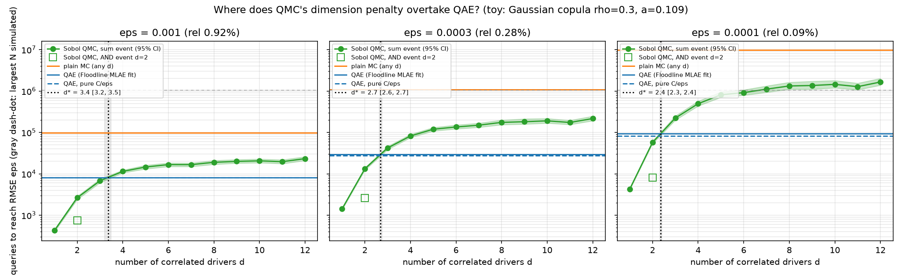

# Floodline: Key West Compound Flood Probability with Quantum Amplitude Estimation

FGCU Quantum Hackathon 2026 candidate build. Self-contained, simulator-only
(`RUN_ON_HARDWARE = False` in `experiment.py`).

Reference docs: [FINDINGS.md](FINDINGS.md) (where quantum wins and loses), [NOVELTIES.md](NOVELTIES.md) (what is new), [CITATIONS.md](CITATIONS.md) (every source).

## Verdict first

We estimate one number: the probability, in a given year at today's sea level, that a
frequently flooded Key West street (Patterson Ave at 3rd St) is under at least 6 inches of
water from tide plus rain the storm drains can't get rid of. We estimate it three ways at
matched query budgets: quantum amplitude estimation (MLAE), plain Monte Carlo and Sobol
quasi-Monte Carlo. Then we run the same benchmark with the old flood rule, a rectangle
(tide above a line AND rain above a line), on the same data and the same circuit design.

| | rectangle rule | realistic rule (this branch) |
|---|---|---|
| flood boundary in (tide, rain) | axis-aligned box | curved staircase (drainage physics) |
| a = P(flood per year) | 0.0959 | 0.640 |
| α MLAE (quantum) | 1.20 [1.15, 1.25] | 0.91 [0.89, 0.94] |
| α plain MC | 1.89 [1.80, 2.00] | 2.01 [1.90, 2.15] |
| α Sobol QMC | 1.18 [1.14, 1.22] | 1.14 [1.11, 1.19] |
| MLAE queries ÷ QMC queries, ε = 1e-3 / 3e-4 / 1e-4 | 3.2× / 3.3× / 3.4× | 4.0× / 3.0× / 2.3× |

α is the fitted exponent in queries ∝ ε^(-α), with a 95% bootstrap CI in brackets. Smaller is
better. Textbook values: QAE 1, MC 2. The rectangle column is rerun on this branch's model,
with the corrected rain fit and 5 rain qubits. master's numbers on the older model are kept
in "Results" below.

**The hypothesis did not hold.** It predicted that a realistic, non-axis-aligned flood
boundary would worsen Sobol QMC's exponent and narrow the QAE/QMC gap. QMC's exponent did not
move: Δα(QMC) = −0.04, 95% CI [−0.09, +0.02], which is no difference. The best classical
method still needs 2.3-4.0× fewer queries than quantum amplitude estimation at every ε we
tested. The quadratic speed-up over plain Monte Carlo holds clearly under both rules: MC needs
28× / 105× / 351× more queries than MLAE at ε = 1e-3 / 3e-4 / 1e-4 under the realistic rule.

**Why QMC didn't degrade (our explanation; we have not tested it separately).** The problem is
discretized. Each driver lives on 32 bins, and each
bin is an interval in Sobol's unit square. So any flood rule on the grid, however curved in
physical units, is a union of axis-aligned boxes in the coordinates QMC actually samples. Here
the staircase has about 8 steps. At our largest budget (13,300 points), Sobol resolves about
1/√N ≈ 0.009 per axis, which is much finer than those steps, so QMC sees boxes and converges
as it does on boxes. The continuous-boundary penalty from the toy study below (α ≈ 1.34 at
d = 2) only appears once the steps are finer than Sobol's resolution. Getting there would take
roughly 7+ qubits per driver, and every extra qubit makes state preparation deeper.

**The gap moved, but not for the predicted reason.** The ratio went from 3.2× to 4.0× at
ε = 1e-3 (wider) and from 3.4× to 2.3× at 1e-4 (narrower). That change comes from MLAE's
fitted exponent (Δα(QAE) = −0.29 [−0.34, −0.23]), not from QMC's. An exponent below 1 cannot
persist, because 1/ε is the quantum limit. So this is a pre-asymptotic feature of the fitted
range (K = 3..7). The 3e-4 and 1e-4 rows are also extrapolated for MLAE, whose smallest
measured RMSE is 6.5e-4. Do not read "the gap closes at small ε" into it. The ε = 1e-3 row is
inside the measured range.

**Hardware:** the realistic circuit is 19 qubits. A costs 11,384 CZ and one Grover step Q
costs 21,944 CZ, against master's 1,437 / 3,677. A alone is about 44× the device's noise
budget, and the noisy simulation returns a coin flip.

Pitch it as follows. We measured the provable quadratic speed-up over Monte Carlo on a
physically grounded Key West flood model. We tested whether realistic flood physics erodes
the best classical method's edge, and found that at the resolution a quantum register can
afford, it doesn't. Do not pitch it as "quantum beats classical".

## What this branch changed, and one correction

1. **Flood rule.** The old event was "annual-max tide ≥ NWS minor AND annual-max 24-h rain ≥
   10-year depth". That is a rectangle in (tide, rain), and Sobol point sets are
   equidistributed over exactly that shape, so it is QMC's best case. The new rule is a
   lumped stormwater model of one real low street, built from the City of Key West's own
   stormwater master plan (`drainage.py`, next section). Its boundary bends because high tide
   cuts drainage.
2. **Correction to master's README.** It said the tide-alone probability at NWS minor stage
   was 0.0458. That number is the NWS *major* stage probability. Annual-max water level at
   Key West reaches minor stage in 96.3% of years (median annual max is 0.41 m above MHHW,
   minor is 0.335 m). It also said the compound AND event was "2.4× more likely than the tide
   threshold alone", which is impossible: an AND event can't be more likely than either of its
   parts. On this branch's model, the rectangle event (a = 0.0959) sits just below both of its
   parts: P(tide ≥ minor) = 0.963 and P(rain ≥ 10-yr) = 0.108. So the old "compound" event was
   almost entirely the rain condition, close to a 1-D problem.
3. **Rain marginal refit (GEV, not Gumbel).** master fit a two-parameter Gumbel by OLS to
   NOAA Atlas 14's nine published depths. That fit gave a 2-year depth of 2.57 in when NOAA
   publishes 4.40 in (42% low), and it placed the "10-year" depth at roughly an 8-year
   exceedance. The realistic rule turns on 2-10 year rain, so this had to be fixed. A
   three-parameter GEV fit by least squares to the same nine points is within 0.23 in of every
   one of them (`rainfall.py`). This is why the rectangle a moved from 0.1090 to 0.0959.
4. **Resolution.** Rain now uses 5 qubits (32 bins of 0.466 in) instead of 3, so the curved
   boundary spans several steps instead of one.
5. **Oracle.** Both rules now use one reversible-adder circuit (described under Method below).

## The realistic flood rule (`drainage.py`)

The site is Patterson Avenue at 2nd/3rd Street, node N3210 in Study Area 1B of the City of Key
West's **2024 Stormwater Master Plan Update** (SMP,
<https://www.cityofkeywest-fl.gov/DocumentCenter/View/12555/Stormwater-Master-Plan_Final_02_2024>).
The SMP describes this area as follows: "frequently flooded intersections are at or near
elevation 1.0 foot NAVD 88" (sec 3.2.2). Elevations are in ft NAVD88. NOAA's station datums
put MHHW 0.013 m above NAVD88 (`flood.mhhw_above_navd88()`, cached NOAA data).

**Sourced numbers (all from the SMP):**

| quantity | value | where |
|---|---|---|
| roadway low point, N3210 | 1.12 ft | Table 3-4 |
| existing 10-yr 24-h peak stage, 1-ft tide boundary | 2.06 ft | Table 3-4 |
| same, 2.7-ft tide boundary | 2.37 ft (below the tide, so outfalls are backed up) | Table 3-4 |
| 10-yr 24-h design storm | 7.6 in | Table 2-2 |
| SCS curve number, high-density residential (60% impervious) | 91 | Table 2-6; SMP's model uses the CN method (sec 2.3.4.7) |
| gravity wells: no flow until stage ≈ 1.6 ft with groundwater at MHHW; groundwater "fluctuates with the tide" | | sec 2.3.4.8 |
| road-flooding test depth: "a 6-inch threshold ... commonly used to test emergency vehicle access" | 0.5 ft | sec 2.5.1 |

**The model, step by step:**
1. Rain becomes runoff by the SCS curve-number formula (CN 91, Ia = 0.2 S).
2. Runoff left in the system raises the stage at the low point by s ft per inch.
   s = (2.37 − 1.12) / runoff(7.6 in) = 0.191 ft/in, calibrated to the SMP's no-outflow run.
3. Drainage during the storm, D(tide), shrinks as the tide rises, because outfall head
   (stage − tide) shrinks. This is the tidal-backflow interaction. D(1.0 ft) = 1.62 in of
   runoff, calibrated from the 0.31 ft difference between the SMP's 1-ft and 2.7-ft tide runs.
   D = 0 once the tide reaches 2.37 ft. Gravity wells add nothing below the flood threshold:
   they need about 1.6 ft of stage over tide-level groundwater, which is already above 1.62 ft.
   This node's basin has no pressurized wells.
4. A tide above the low point stands in the street, and runoff stacks on top of it.
5. Flood means stage ≥ 1.12 + 0.5 = 1.62 ft NAVD88.

Each (tide, rain) cell is judged at its midpoint. The flood boundary moves from rain ≥ 6.1 in
at low tides to rain ≥ 2.3 in at a tide of 1.55 ft. From 1.68 ft up, tide alone floods the
street. The boundary is drawn in `results.png`, top left. This rule is an OR, not an AND, so
it can exceed its tide-only part. Tide alone floods the street (tide bins ≥ 1.68 ft) in 0.217
of years. Adding rain that the tide-throttled drains can't clear raises that to a = 0.640,
about 2.9× the tide-only figure.

**Cross-checks against independent NOAA numbers.** NWS minor flood stage at this gauge,
defined by observed street flooding, is 1.14 ft NAVD88. That is within 0.02 ft of N3210's low
point. NWS moderate stage is 1.64 ft, within 0.02 ft of the 1.62 ft flood threshold. Neither
NOAA number was used to build the model.

**ASSUMPTIONS, NOT MEASURED** (each is also marked in `drainage.py`):
- Storage is prismatic: s is a constant, so stage is linear in runoff. The SMP's real storage
  comes from a LiDAR DEM that its text does not give.
- Drainage scales as the square root of head, as in turbulent pipe flow. Head is taken as
  2.37 ft − tide and does not depend on storm size. The SMP's rating curves exist only inside
  its model.
- Tide intrudes into the street through porous limestone and unvalved drains. The SMP model
  has flap gates on every outfall, so it has no intrusion. The NWS minor-stage match above
  supports this assumption but does not prove it.
- Co-occurrence (inherited from the rectangle rule and made more important here): each year's
  annual-max tide and annual-max 24-h rain are treated as one event, linked by the copula
  (τ = 0.3, also an assumption, see below). Real annual peaks rarely coincide, so a is
  overstated. 0.640 means "most years" for this worst-case street under that pairing. It
  should not be quoted as a forecast.
- One node stands in for "Key West".

Every estimator (quantum, MC, QMC) sees the same discretized joint model and the same integer
flood test. The comparison is about convergence, not about whether a is right.

## Data (unchanged except the rain refit)

**Tide** (`flood.py`): NOAA CO-OPS station 8724580 (Key West), `monthly_mean` product,
`Highest` column, MHHW datum, 1913-2025. Annual maxima are taken for the 110 years with at
least 10 months of data, shifted to 2025 sea level using our fitted trend of 2.65 mm/yr (NOAA
publishes 2.64 ± 0.15 mm/yr for this station), then GEV-fit and binned onto 32 bins of 4 cm.

**Rain** (`rainfall.py`): NOAA Atlas 14 PFDS 24-hour annual-maximum-series depths at the tide
station's coordinates (4.40 ... 23.3 in for 2 ... 1000 yr). GEV fit as described above,
binned onto 32 bins of 0.466 in.

**Joint** (`copula.py`): a discretized Gaussian copula. Wahl et al. 2015 (*Nature Climate
Change*, doi:10.1038/nclimate2736) found significant compound dependence between storm surge
and precipitation at virtually all Gulf/east coast sites, including the Key West gauge per
their Fig. 1b. Their variables (daily surge vs daily rain) differ from ours (annual-max total
water level vs annual-max 24-h rain). They report the Key West τ only in a figure, so τ = 0.3
(ρ = 0.454) is an **ASSUMPTION, NOT MEASURED**. The circuit loads the tide marginal, then
controlled-loads one of 4 regime-conditional rain distributions selected by the tide's top 2
bits. The classical samplers draw from the same generative model.

## Method

**Oracle: a reversible adder, for both rules.** The realistic rule is separable: stage − 1.62
ft = G_tide(tide) + G_rain(rain). `drainage.integer_tables()` rescales both terms to integers,
in units of 0.0125 ft. It picks the coarsest unit at which the integer test a[tide] + b[rain] ≥
0 reproduces the floating-point rule on all 1,024 cells. a ranges from −75 to 0 and b from 0
to 75, so the sum fits an 8-bit two's-complement register. The circuit (`copula.flood_oracle`)
is a Draper QFT adder generalized from adding a constant to adding an integer function of a
register. It applies H to the accumulator (that is QFT|0⟩), then for each accumulator bit k a
diagonal phase exp(2πi·a[x]·2^k/2^8) on (tide register, bit k), the same for rain, then an
inverse QFT. The sign bit, NOTed, goes to the objective qubit, and the adder is uncomputed.
The rectangle rule is the same circuit with a, b ∈ {−1, 0} and a 2-bit accumulator. Width is
19 logical qubits (realistic) or 13 (rectangle).

**Correctness checks (`smoke_test.py`, both rules):**
1. Oracle truth table: one statevector run on a uniform superposition of all 1,024 (tide,
   rain) inputs. obj must equal the flood mask on every input, and the accumulator must
   return to |0⟩.
2. Grover law: the exact P(obj = 1) after Q^m A for m ∈ {0, 1, 2, 4} must match the closed
   form sin²((2m+1)θ) with a = sin²θ. Max |diff| is 1.5e-13 (rectangle) and 2.7e-13
   (realistic).
3. The classical sampler's hit rate over 400k draws must equal a within 5σ.

The existing tide-only checks (law, `StatevectorSampler` agreement) are kept.

**Estimators and accounting** are unchanged from master. MLAE (Suzuki et al., *Quantum Inf.
Process.* 19, 75, 2020, arXiv:1904.10246) runs m ∈ {0, 1, 2, 4, …, 32} with 100 shots each.
The O(1/ε) amplitude-estimation bound is from Brassard, Høyer, Mosca & Tapp,
arXiv:quant-ph/0005055. One call of A or A† is one query, the same unit as one classical draw.
The exact P(obj = 1) for every m comes from one Aer statevector run of the assembled,
un-flattened circuit (see `qae.exact_hit_probs` for why it must be done that way). Binomial
shots are then drawn from those probabilities. Plain MC is Binomial(N, a). QMC uses scrambled
2-D Sobol points pushed through the same sampler and mask.

**Measurement discipline:** 500 seeded trials per (arm, budget). RMSE is measured against a.
α comes from an OLS fit of log RMSE on log queries over K = 3..7, with 95% CIs from 2,000
bootstrap resamples of trials. Matched-ε queries and their paired ratios come from the same
bootstrap. Δα between rules is the difference of the two independent bootstrap distributions.
A difference whose CI covers 0 is reported as no difference.

## Results (`results.json` realistic, `results_rectangle.json` rectangle, `results.png`)


**Fitted exponent α (queries ∝ ε^-α), 95% bootstrap CI:**

| arm | master (rectangle, Gumbel rain, 3 rain qubits) | rectangle (this branch) | realistic (this branch) | Δα realistic − rectangle |
|---|---|---|---|---|
| MLAE (quantum) | 1.06 [1.01, 1.12] | 1.20 [1.15, 1.25] | 0.91 [0.89, 0.94] | −0.29 [−0.34, −0.23] |
| plain MC | 2.06 [1.94, 2.20] | 1.89 [1.80, 2.00] | 2.01 [1.90, 2.15] | +0.12 [−0.04, +0.28] (none) |
| Sobol QMC | 1.16 [1.12, 1.20] | 1.18 [1.14, 1.22] | 1.14 [1.11, 1.19] | −0.04 [−0.09, +0.02] (none) |
| a | 0.1090 | 0.0959 | 0.6400 | |

**Queries needed at matched absolute error ε** (median of bootstrap fits; ratio CIs paired):

| rule | ε (relative) | MLAE | plain MC | MC ÷ MLAE | Sobol QMC | MLAE ÷ QMC |
|---|---|---|---|---|---|---|
| master rectangle | 1e-3 (0.9%) | 8.2k | 107k | 13.1× | 1.8k | 4.6× [4.2, 4.9] |
| master rectangle | 1e-4 (0.09%) | 93.4k | 12.3M | 131× | 25.6k | 3.7× [3.0, 4.4] |
| rectangle | 1e-3 (1.0%) | 5.4k | 71k | 13.3× [11.3, 16.1] | 1.7k | 3.2× [3.0, 3.4] |
| rectangle | 3e-4 (0.31%) | 22.7k | 698k | 30.8× [23.1, 42.3] | 6.9k | 3.3× [3.0, 3.6] |
| rectangle | 1e-4 (0.10%) | 84.7k | 5.6M | 66× [44, 104] | 25.2k | 3.4× [2.9, 3.9] |
| realistic | 1e-3 (0.16%) | 8.8k | 245k | 27.7× [21.8, 36.5] | 2.2k | 4.0× [3.8, 4.2] |
| realistic | 3e-4 (0.05%) | 26.5k | 2.77M | 105× [72, 162] | 8.7k | 3.0× [2.8, 3.3] |
| realistic | 1e-4 (0.02%) | 72.0k | 25.3M | 351× [213, 632] | 30.8k | 2.3× [2.1, 2.7] |

Smallest measured RMSE: MLAE 4.6e-4 (rectangle) and 6.5e-4 (realistic); QMC 1.6e-4 and
2.0e-4. Rows below those values are fit extrapolations. The two rules have different a, so
the same absolute ε is a different relative error. a(1 − a) is 2.6× larger under the
realistic rule, which is why MC needs more queries there.

## How the gap scales with the number of drivers (`crossover.png`)



A separate toy study (not in this repo's pipeline) used d correlated Gaussian drivers and a
non-axis-aligned weighted-sum flood event. Sobol QMC's fitted α followed the He-Owen
2d/(d+1) rate: 1.00 / 1.34 / 1.52 / 1.64 / 1.84 for d = 1 / 2 / 3 / 4 / 8. The axis-aligned
AND event at d = 2 gave α = 1.03. Against the measured Floodline MLAE line (master's, α = 1.06),
QMC needs more queries than QAE from about d = 3 (crossover d* = 3.4 / 2.7 / 2.4 at ε = 1e-3 /
3e-4 / 1e-4). The real two-driver data point from this branch is QMC α = 1.14 [1.11, 1.19] on the
realistic boundary, against the toy's 1.34 for a diagonal and 1.03 for a box.

Caveats, which matter as much as the curve:
- A linear (weighted-sum) event is secretly 1-D. A classical method that rotates coordinates
  or conditions on the other drivers beats it easily, so the toy says nothing about *linear*
  events. It only matters because real flood physics is nonlinear (curve-number runoff,
  square-root drainage, thresholds), which blocks those tricks.
- The d ≥ 7 crossover points at ε = 1e-4 are extrapolated beyond the fitted range.
- Query counts ignore circuit growth and noise. Each added driver adds a register and its
  state preparation, and that circuit is already far past today's hardware (next section).

## Hardware realism (the big caveat)

Transpiled to IBM Heron (`FakeFez`, heavy-hex, CZ basis, opt level 3). Error rates come from
the recorded calibration snapshot that ships with qiskit-ibm-runtime, not from a live device.

| | rectangle (13 qubits) | realistic (19 qubits) | master (17 qubits) |
|---|---|---|---|
| flood oracle alone | 464 CZ | 4,576 CZ | (comparators) |
| `A` (state prep + oracle) | 7,166 CZ | 11,384 CZ | 1,437 CZ |
| `Q` (one Grover step) | 13,345 CZ | 21,944 CZ | 3,677 CZ |
| `Q^32 A` (largest run) | 434,206 CZ | 713,592 CZ | 119,101 CZ |

Most of the growth over master is state preparation. Going from 3 to 5 rain qubits makes each
of the four regime-controlled rain loads synthesize far deeper. The realistic adder oracle
costs about 10× the rectangle's, because each of its 8 accumulator bits needs two
multi-qubit diagonal phase gates, computed and then uncomputed. The median FakeFez CZ error is
3.9e-3, which allows roughly 256 CZ before noise dominates, so the realistic A is about 44×
over budget. In the noisy simulation (Aer with the FakeFez snapshot restricted to the 19 qubits
used, see `restricted_noise`), P(obj = 1) is 0.50 at both m = 0 and m = 1, against ideal
values of 0.640 and 0.124. Only 8 shots per point were run. Each noisy shot of A alone took
about 72 s to simulate, and with A's ideal-circuit fidelity near zero, more shots would only
pin down a coin flip more precisely.

Exact (ideal) simulation time for the full schedule: 103 s (rectangle) and 823 s (realistic).
The whole `experiment.py` run took 45 min on 8 cores.

## Demo

`demo.py` animates one live seeded run of all three estimators on the realistic rule,
stepping through the benchmark's query budgets. The "converged" markers are read from
`results.json`'s ε = 1e-3 row, so an unlucky live draw cannot contradict the table.
On the realistic rule: MLAE converges at about 8.8k queries, Sobol QMC at about 2.2k, and
plain MC needs about 245k (off-screen).
Run: `uv run python demo.py` (precompute ≈ 15 min, dominated by the exact circuit simulation,
then an animated window that needs a display).

## What this does not demonstrate

1. **No advantage over the best classical method.** Sobol QMC needs 2.3-4.0× fewer queries than MLAE at every ε, under both
   rules. The realistic boundary did not change QMC's exponent (see Verdict for why).
2. **No hardware speed-up.** A alone is roughly 44× the device's noise budget (see above).
3. **Query count is not wall-clock time.** One quantum query costs far more than one classical
   draw.
4. **a is a model.** The GEV fits, τ = 0.3, the co-occurrence pairing and the drainage
   assumptions all carry uncertainty far larger than ε = 1e-4. A better estimator of a does
   not make the flood probability better known.

## Files

- `flood.py`: NOAA tide fetch/cache, detrending, GEV fit, discretization, NAVD88 offset.
- `rainfall.py`: NOAA Atlas 14 fetch/cache, GEV fit to the published curve, discretization.
- `drainage.py`: the realistic low-street flood rule (sources and assumptions in its docstring).
- `copula.py`: copula joint model, state prep, the adder oracle, flood rules, classical sampler.
- `qae.py`: Grover operator, MLAE, exact hit probabilities.
- `experiment.py`: the three-arm benchmark for both rules, fits, Δα, hardware cost, noisy run,
  plot.
- `smoke_test.py`: oracle truth tables, the closed-form law on every circuit, sampler
  agreement, a tiny end-to-end run.
- `demo.py`: live animated convergence demo.
- `crossover.png`: the d-driver toy study's figure (the script lives outside this repo).
- `multidriver.py` and friends: the separate five-driver model, documented in
  `README_multidriver.md`. It shares this model's tide GEV (`flood.py`), the same Atlas 14 GEV
  rain fit (`rainfall.fit_gev`, applied to the 24-h and 3-h series) and the same SMP sources. It
  differs on purpose in three places: τ = 0.2 (prior 0.1-0.3) instead of 0.3, a drainage rule
  calibrated to the SMP's 5-year level of service with groundwater and gravity wells instead of
  the N3210 storage fit, and SLR and groundwater as random drivers. Both models let tide stand
  in the street. Their tide-only probabilities at N3210 today agree (0.210 vs 0.217); their
  full a does not (0.97 vs 0.640), because the two drainage calibrations differ.

## Run

```
uv sync
uv run python smoke_test.py   # ~3 min
uv run python experiment.py   # ~45 min, writes results.json, results_rectangle.json, results.png
uv run python demo.py
uv run ruff check . && uv run mypy .
```
