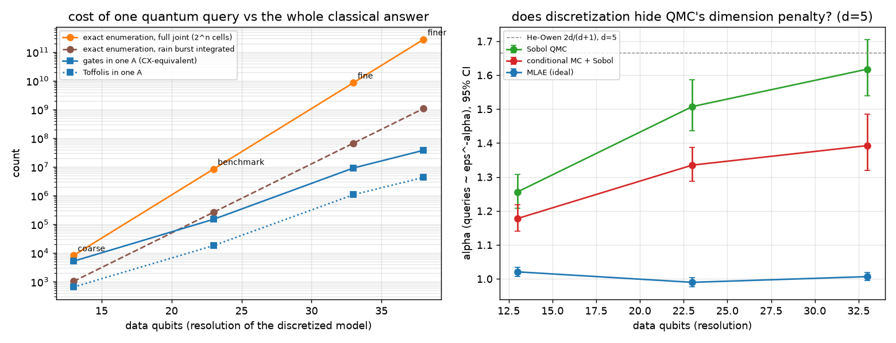
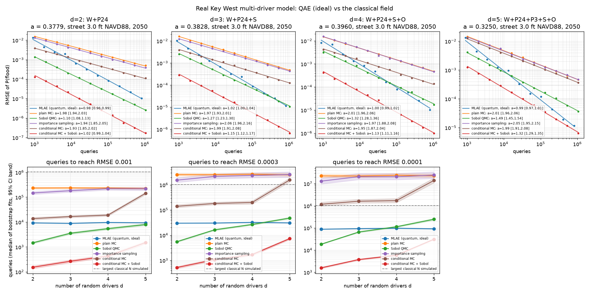

# Floodline, multi-driver: does QAE beat the best classical method on the real Key West problem?

## Verdict

**No. On the real Key West model, the strongest classical method beats ideal QAE at every
number of drivers, every precision and both streets we tested.**

- **The toy's crossover reproduces, but only against plain Sobol QMC.** On the real, discretized
  five-driver model, QMC's exponent grows with the number of random drivers d: α = 1.10, 1.27,
  1.32, 1.49 for d = 2, 3, 4, 5 (street at 3.0 ft). Ideal QAE stays at α ≈ 1.0. QAE needs fewer
  queries than plain QMC from d* ≈ 4.3 at ε = 3e-4 and d* ≈ 3.7 at ε = 1e-4. At d = 5 and
  ε = 1e-4, QMC needs 2.7× [2.4, 3.0] more queries than QAE. The 6.0 ft street gives d* = 4.9 /
  4.3 / 3.9 at ε = 1e-3 / 3e-4 / 1e-4.
- **The smart classical opponent removes it.** Conditional Monte Carlo integrates the rain
  burst exactly, because the flood rule is monotone in it, and runs Sobol points over the other
  d - 1 drivers. That needs **0.12-0.34× QAE's queries at d = 5** (95% CIs exclude 1), and 0.02-0.06×
  at d ≤ 4. It is the best classical arm in all 24 (street, d, ε) cells, and QAE never beats it.
- **Exact enumeration beats both on cost.** At d = 5 the discretized model has 2^23 cells.
  Enumerating the other drivers with the rain burst integrated exactly takes 2.6e5 rule
  evaluations and gives a with zero sampling error. One application of the QAE circuit A is
  already 149k CX (18k Toffoli), and QAE needs about 9e4 of them for ε = 1e-4. **Every
  crossover in this study exists only in query count.** In total work, exact enumeration of the
  discretized model wins outright at every resolution we tested (13 to 38 data qubits).
- **Discretization does not explain away QMC's penalty at realistic resolution.** QMC's d = 5
  exponent is 1.26 on a coarse grid, 1.51 on the benchmark grid and 1.62 on a fine one, close to
  the continuous He-Owen 1.67. Coarse grids soften the penalty, which matches the 2-driver
  branch's finding on 32 bins. Fine grids do not.
- **The one place QAE leads is black-box accounting.** If the flood model were a black-box
  simulator, conditional MC would have to find each rain threshold by bisection: 6 runs per
  sample instead of 1. Then QAE needs fewer queries at d = 5 and ε ≤ 3e-4: 1.4-2.0× fewer at the
  3.0 ft street (at ε = 1e-4, CMC+QMC needs 3.1e4 × 6 = 1.9e5 against QAE's 9.2e4), and 1.0-1.4×
  at 6.0 ft, where ε = 3e-4 is a tie. At d ≤ 4 the classical method still wins even with the ×6. That is a query-count win of under 2× which
  disappears once a query's cost is counted. A smarter threshold search (warm starts, secant
  steps) would also shrink it.
- **Hardware.** At d = 5 and ε = 1e-4 the deepest MLAE circuit, Q^256 A, has 7.7e7 CX (9.2e6
  Toffoli) on 52 logical qubits. For it to succeed even half the time, each two-qubit gate needs
  an error below about 1e-8, roughly five orders of magnitude better than today's ~1e-3. This
  is fault-tolerant territory, and the counts assume an error-free circuit.

**What this means for the pitch:** the honest claim is "we built the full five-driver circuit,
verified it to 1e-14, measured QAE's quadratic advantage over plain MC (α 1.0 vs 2.0) and its
crossover over plain QMC at d ≈ 4, and then showed that a skeptic's conditional estimator
removes the crossover on real data." The toy's own caveat holds on the real model. The
compound-flood boundary is monotone in the rain driver, so a classical method can integrate
that dimension out analytically. That is the dimension where QMC's penalty came from.

## The model (`multidriver.py`)

A compound flood model for one Key West street. Five random drivers, a nonlinear drainage
rule, and the same discretized joint distribution for every estimator.

### Drivers

| driver | what | source | discretization (benchmark) |
|---|---|---|---|
| W | annual-max still water level (tide + surge) | NOAA CO-OPS 8724580, 110 usable years 1913-2025, GEV fit, detrended to 2025 (`flood.py`, unchanged) | 64 nodes, 1/8 ft apart, 0.3-8.2 ft NAVD88 |
| P24 | 24-h rain depth | NOAA Atlas 14 AMS, Gumbel fit to the 9 published depths (`rainfall.py`) | 32 bins, 0-24 in |
| P3 | 3-h burst inside that storm | NOAA Atlas 14 AMS 3-h depths, same PFDS query, Gumbel fit | 32 bins, 0-12 in |
| S | sea-level rise from 2025 to the target year | NOAA 2022 Sea Level Rise Technical Report projections for 8724580, CO-OPS API; split normal through (low, central, high) | 16 nodes, 1/8 ft apart, centred on the median |
| O | groundwater offset above the normal high tide | City of Key West 2024 Stormwater Master Plan (SMP) sec 2.1.2: "0.5 foot to 1.5 feet above the tide levels" | 8 nodes, Uniform(0.5, 1.5) ft |

The benchmark is a street at **3.0 ft NAVD88 in 2050, NOAA Intermediate scenario** (+0.66 ft of
rise after 2025, split-normal sigmas 0.24/0.28 ft). That elevation sits between the "frequently
flooded intersections at or near elevation 1.0 foot" and Bahama Village's "4 feet NAVD 88 or
less" (both SMP). It was fixed before any query counts were looked at. A second street at
6.0 ft repeats the whole study.

### Flood rule

At the critical stage z + 0.5 ft (the SMP's 6-inch road tolerance):

```
C = W + S                         coastal stage; outfalls back up to it (check valves assumed)
G = MHHW + S + O                  groundwater stage
S_r = (1000/CN - 10) * clip((z - G)/4 ft, 0, 1)        SCS soil retention, shrinks as groundwater rises
R = Q(Pa + P3) - Q(Pa),  Pa = (P24 - P3)/2,  Q = SCS-CN runoff, nonlinear in rain
D = 3 h * [k_out * sqrt(max(z + 0.5 - C, 0)) + k_well * max(z + 0.5 - G - 1.6, 0)]
p = 3 * max(R - D, 0) / 12        ponding depth, ft
flood  <=>  max(C, G, z) - z + p >= 0.5 ft
```

Drainage capacity falls as tide + SLR rise (outfall head) and as groundwater + SLR rise (gravity
wells take nothing until the ponded stage is 1.6 ft above groundwater, SMP). Rain enters through
the SCS curve. The rule is folded into two integer tables, `T_int[c, g]` (drainage plus the
remaining tolerance) and `R_int[p24, p3, g >> 2]` (burst runoff), and the indicator is
`R_int >= T_int`. The circuit and every classical sampler use exactly these tables.

### Every number, sourced or flagged

| constant | value | status |
|---|---|---|
| MHHW - NAVD88 | 0.043 ft | NOAA datums file for 8724580 (MHHW 1.941 m, NAVD88 1.928 m above station datum) |
| road tolerance | 0.5 ft | SMP sec 3.1, "up to 6 inches of flooding ... tolerated" |
| curve number | 91 | SMP Table 2-6, high-density residential (table range 88-95) |
| soil depth | 4 ft | SMP, "3 to 5 feet deep"; midpoint |
| well start | 1.6 ft above groundwater | SMP (1.4 ft + 0.2 ft friction); linear above it, per the SMP's own linear assumption |
| groundwater offset | U(0.5, 1.5) ft | SMP range is sourced; **uniform shape is an ASSUMPTION, NOT MEASURED** |
| groundwater follows the normal high tide, not the surge peak | | **ASSUMPTION, NOT MEASURED.** SMP: groundwater "fluctuates with the tides" and is "muted"; no lag or tidal efficiency was found |
| SLR range percentiles | 17th/83rd | **ASSUMPTION, NOT MEASURED.** The API file gives low/central/high columns without saying which percentiles |
| SLR baseline | rise after 2025 | NOAA's projections are zero at 2005; we difference against the 2025 central value, so the baseline cancels. The 2025 spread is ignored (ASSUMPTION, about 2 cm) |
| tide-rain Kendall tau | 0.2 | **ASSUMPTION, NOT MEASURED.** No Key West number is published as text (Wahl et al. 2015 show it only in a figure; Jane et al. 2020 give tau < 0.3 for South Florida). Prior 0.1-0.3, sensitivity reported |
| 24-h / 3-h rain copula rho | 0.8 | **ASSUMPTION, NOT MEASURED.** The 3-h burst is nested in the 24-h total; no joint statistic found. d <= 4 configurations use the comonotone limit |
| annual maxima treated as concurrent | | **ASSUMPTION, NOT MEASURED.** The standard bivariate-annual-maxima shortcut; overstates co-occurrence |
| burst centred in the storm | Pa = (P24 - P3)/2 | **ASSUMPTION** from the SCS Type II / FLMOD shape (peak mid-storm), which the SMP uses |
| catchment-to-ponded-area ratio | 3 | **ASSUMPTION, NOT MEASURED.** No street-level number found |
| drainage calibration | k_out, k_well | **ASSUMPTION, NOT MEASURED.** The SMP states a level-of-service target ("passable during the 5-year storm"), not measured performance. We assume the system exactly meets it at a 4.0 ft street, tide at MHHW, groundwater at the mid offset, Atlas 14 5-yr 24-h and 3-h depths (5.99 in, 3.49 in), with capacity split 50/50 between outfalls and wells |
| copula discretization | top 3 bits | P24 depends on W's top-3-bit regime and P3 on P24's (exact Gaussian-copula block averages). A modeling discretization, shared by every arm |

Sanity checks against the SMP's qualitative statements: a 1.0 ft street floods past 6 in with
probability 0.77 per year today (tide alone: 0.35), consistent with "frequently flooded". A 4 ft
street floods with probability 0.17 per year today, consistent with the anchor. The absolute
probabilities are only as good as the flagged assumptions, the drainage calibration above all.
The model is built to test estimators on a realistic structure; it is not a calibrated
engineering model of any particular street.

Cross-check against the City's own hydraulic model (thanks to the 2-driver branch's
`drainage.py` for finding it): SMP Table 3-4 gives a peak stage of 2.06 ft at node N3210
(Patterson Ave, roadway low point 1.12 ft) for the 10-yr 24-h storm with a 1.0-ft tide
boundary. Our model, calibrated independently from the LOS anchor above, gives 2.07 ft for the
same storm, tide and elevation, using Atlas 14's 10-yr 3-h burst. With the 2.7-ft boundary the
SMP gives 2.37 ft and we give 3.71 ft. The SMP model puts flap gates on every outfall, so the
tide never enters the street. We let tide above the street stand in it (porous limestone,
unvalved drains). That is a deliberate structural difference.

What drives the answer at the 3.0 ft benchmark street (2050, exact; holding one driver at its median):

| held at median | P(flood) | change |
|---|---|---|
| none (full model) | 0.3250 | |
| W, peak water level | 0.3462 | +0.021 |
| P24, 24-h rain | 0.0396 | -0.285 |
| P3, 3-h burst (locked to the 24-h return period instead) | 0.3960 | +0.071 |
| S, sea-level rise | 0.3183 | -0.007 |
| O, groundwater | 0.3275 | +0.003 |
| no rain at all | 0.0133 | |

At 3 ft the event is rain-driven, and tide, SLR and groundwater act by shrinking drainage
capacity. Lower streets are tide-driven: at 1 ft in 2050 the probability is 0.99 with no rain at
all. The tide-rain tau prior barely matters here: a = 0.3274 / 0.3263 / 0.3250 / 0.3236 for
tau = 0 / 0.1 / 0.2 / 0.3. The benchmark grid is close to a finer one: a = 0.3250 against 0.3280
at twice the resolution per driver.

## The quantum side (`multidriver_circuit.py`)

A is a real circuit, not a sketch:

1. **State preparation.** Grover-Rudolph with uniformly controlled RY rotations, in Rosenblatt
   order: W; P24 controlled on W's top 3 bits; P3 controlled on P24's top 3 bits; S; O. That
   costs about 2^(controls + bits) CX per driver (578 CX in total at d = 5), not the 2^23 of a
   generic joint load.
2. **Arithmetic.** Two Cuccaro ripple-carry adders: C = W + S and G = S + O.
3. **Oracle.** Two QROM lookups by unary iteration (Babbush et al. 2018), T_int[C, G] (12
   address bits) and R_int[P24, P3, G >> 2] (13 address bits), then a Cuccaro comparator
   `R_int >= T_int` onto the objective qubit. Work registers stay computed. The ancilla pool
   (adder padding, carry-in, unary-iteration ANDs) comes back to |0> after every block, so the
   S0 reflection skips it.

**Correctness.** `test_multidriver.py` builds the same circuit at reduced resolution (20 qubits,
all five drivers, both adders, both QROMs, the comparator). It also builds the d = 2 path (14
qubits). Both use `qae.exact_hit_probs`: the un-flattened A and Q are composed and then
decomposed once, then run through exact Aer statevector simulation. P(obj = 1) after Q^m A
matches sin²((2m+1)θ) with a = `Model.exact()` to 2.6e-14 for m = 0, 1, 2, 4. The same test
checks that plain sampling, conditional MC and importance sampling are unbiased on 400k real
draws, and that the runoff table is monotone, which the bisection needs. The gate counter used
for large grids (`count_a`) reproduces the built circuit's CCX/CX/UCRY counts exactly at the
benchmark resolution.

**Full-resolution QAE statistics are not simulated.** A 52-qubit statevector does not fit in
memory. The MLAE arm draws binomial shots from the closed form sin²((2m+1)θ) with the exact a.
That **assumes a correct, fault-free circuit**. The reduced-scale test is the evidence that the
construction is correct. Nothing at full scale shows it.

**Resource counts** (logical, all-to-all; CX after `transpile(basis_gates=["cx","u"],
optimization_level=1)`, Toffoli = CCX in our construction before synthesis):

| d | drivers | data qubits | total qubits | A: CX | A: Toffoli | Q: CX | Q: Toffoli (excl. S0) | full-joint cells | enumeration evals (rain burst exact) |
|---|---|---|---|---|---|---|---|---|---|
| 2 | W, P24 | 11 | 31 | 1,284 | 120 | 2,850 | 240 | 2,048 | 64 |
| 3 | + S | 15 | 41 | 10,250 | 1,266 | 20,842 | 2,532 | 32,768 | 1,024 |
| 4 | + O | 18 | 46 | 17,307 | 2,154 | 35,004 | 4,308 | 262,144 | 8,192 |
| 5 | + P3 | 23 | 52 | 148,813 | 18,026 | 298,076 | 36,052 | 8,388,608 | 262,144 |

**Fidelity needed** (3.0 ft street; MLAE with 100 shots per Grover power):

| d | ε | deepest circuit | CX in it | Toffoli in it | 2q error for 50% success | Toffolis over the whole run |
|---|---|---|---|---|---|---|
| 2 | 1e-3 | Q^32 A | 9.3e4 | 7.8e3 | 7e-6 | 1.1e6 |
| 5 | 1e-3 | Q^32 A | 9.7e6 | 1.2e6 | 7e-8 | 1.7e8 |
| 5 | 1e-4 | Q^256 A | 7.7e7 | 9.2e6 | 9e-9 | 1.7e9 |

Today's best two-qubit gates are near 1e-3 (the repo's FakeFez snapshot has a median CZ error of
3.9e-3), so even d = 2 at ε = 1e-3 is out of reach without error correction. The main README
shows the noisy simulation washing out by m = 2.

**The tables are a classical cost too.** The oracle's QROMs hold 2^12 + 2^13 precomputed
sub-model values (drainage over (C, G), burst runoff over (P24, P3, G)). Computing them is
cheap here, but it is the same order as the 2.6e5-evaluation enumeration that solves the d = 5
problem outright. Query count is the right metric only when A is a cheap circuit wrapped around
an expensive simulator. Here A is a lookup table of a cheap-to-enumerate grid, and the honest
comparison is total work. On total work, enumeration wins by orders of magnitude: 2.6e5 rule
evaluations against 9e4 queries × 1.5e5 CX.

## The classical side and the crossover (`experiment_multi.py`)

Protocol (fixed before running): every arm samples the same discretized model through the same
integer tables. One query is one flood-rule evaluation, or one application of A / A†. Classical
budgets run from N = 2^10 to 2^20 with 128 replicates (plain MC 512). MLAE uses K = 1..13
(m ≤ 2048), 100 shots per power and 500 trials. Exponents come from an OLS fit of log RMSE on
log queries, with 2000-resample bootstrap CIs. Matched-ε queries are read off each bootstrap
fit. A ratio whose 95% CI contains 1 is a tie.

Arms: **mc** plain MC; **qmc** scrambled Sobol over all d drivers; **is** importance sampling
(exponential tilt of every driver toward high bins, tilt picked on a 7 × 16k-sample pilot whose
cost is *not* added below); **cmc** conditional MC, with the rain-chain leaf (P3 at d = 5,
otherwise P24) integrated exactly and iid draws over the rest; **cmc_qmc** the same on Sobol
points; **qae** MLAE (ideal).

### Exponents α (queries ∝ ε^-α), 95% CI, street at 3.0 ft, 2050 Intermediate

| d | drivers | a | QAE | plain MC | Sobol QMC | IS | cond. MC | cond. MC + Sobol |
|---|---|---|---|---|---|---|---|---|
| 2 | W, P24 | 0.3779 | 0.98 [0.96, 0.99] | 1.98 [1.94, 2.03] | 1.10 [1.08, 1.13] | 1.94 [1.85, 2.05] | 1.93 [1.85, 2.02] | 1.02 [0.99, 1.04] |
| 3 | + S | 0.3828 | 1.02 [1.00, 1.04] | 1.97 [1.93, 2.01] | 1.27 [1.23, 1.30] | 2.06 [1.96, 2.16] | 1.99 [1.91, 2.08] | 1.15 [1.12, 1.17] |
| 4 | + O | 0.3960 | 1.00 [0.99, 1.02] | 2.01 [1.96, 2.06] | 1.32 [1.28, 1.36] | 1.97 [1.88, 2.08] | 1.95 [1.87, 2.04] | 1.13 [1.11, 1.16] |
| 5 | + P3 | 0.3250 | 0.99 [0.97, 1.01] | 2.01 [1.96, 2.06] | 1.49 [1.45, 1.54] | 2.05 [1.95, 2.15] | 1.99 [1.91, 2.08] | 1.32 [1.29, 1.35] |

The He-Owen rate for an indicator with a smooth boundary is 2d/(d+1) = 1.33 / 1.50 / 1.60 / 1.67.
The measured QMC exponents sit below it but rise with d the same way. Discretization does not
hide the penalty on this model (see the resolution check below).

### Queries at matched ε (median of bootstrap fits; ratio to QAE with 95% CI; * = extrapolated past N = 2^20)

ε = 3e-4 (about 0.1% relative):

| d | QAE | plain MC | Sobol QMC | IS | cond. MC | cond. MC + Sobol | enumeration |
|---|---|---|---|---|---|---|---|
| 2 | 30.1k | 2.55M* (85×) | 5.5k (0.18× [0.17, 0.20]) | 1.5M* (51×) | 141k (4.7×) | **520 (0.017×)** | 64 |
| 3 | 30.4k | 2.54M* (84×) | 16.3k (0.54× [0.50, 0.58]) | 2.2M* (71×) | 182k (6.0×) | **1.06k (0.035×)** | 1,024 |
| 4 | 32.4k | 2.64M* (81×) | 26.6k (0.82× [0.76, 0.89]) | 2.4M* (73×) | 200k (6.2×) | **1.69k (0.052×)** | 8,192 |
| 5 | 30.9k | 2.52M* (82×) | 48.0k (**1.6×** [1.4, 1.7]) | 2.6M* (84×) | 1.57M* (51×) | **7.3k (0.24× [0.21, 0.26])** | 262,144 |

ε = 1e-4 (about 0.03% relative):

| d | QAE | plain MC | Sobol QMC | IS | cond. MC | cond. MC + Sobol | enumeration |
|---|---|---|---|---|---|---|---|
| 2 | 87.8k | 22.5M* (256×) | 18.6k (0.21× [0.20, 0.22]) | 13.1M* | 1.18M* (13×) | **1.6k (0.018×)** | 64 |
| 3 | 93.4k | 22.2M* (238×) | 65.7k (0.70× [0.65, 0.76]) | 20.8M* | 1.62M* (17×) | **3.7k (0.040×)** | 1,024 |
| 4 | 97.6k | 24.0M* (246×) | 113k (**1.2×** [1.1, 1.3]) | 20.6M* | 1.72M* (18×) | **5.9k (0.060×)** | 8,192 |
| 5 | 91.8k | 22.9M* (249×) | 247k (**2.7×** [2.4, 3.0]) | 24.5M* | 14.0M* (152×) | **31.0k (0.34× [0.31, 0.37])** | 262,144 |

At ε = 1e-3, conditional MC + Sobol needs 0.017-0.16× QAE's queries, and plain QMC 0.16-0.85×.
All 24 cells for both streets are in `results_multi.json`.

**Crossover d\*** (interpolated d where the arm first needs more queries than QAE):

| street | arm | ε = 1e-3 | ε = 3e-4 | ε = 1e-4 |
|---|---|---|---|---|
| 3.0 ft (a ≈ 0.33-0.40) | Sobol QMC | none up to d = 5 | 4.3 | 3.7 |
| 6.0 ft (a ≈ 0.10-0.13) | Sobol QMC | 4.9 | 4.3 | 3.9 |
| both | conditional MC + Sobol | none | none | none |

Two things stand out. Importance sampling is useless here: these events are not rare (a ≈ 0.1
to 0.4), and IS is a rare-event tool. Plain conditional MC with iid draws loses badly at d = 5,
because integrating P3 leaves P24's variance in place. It is the Sobol points over the
remaining low-dimensional, nearly smooth conditional integrand that make the skeptic's method
strong.

### Does discretization hide QMC's penalty? And what does A cost against enumeration? (`experiment_resolution.py`)

The 2-driver branch found that QMC's exponent did not degrade on a realistic boundary and
suggested discretization as the reason: on a 32-bin grid every boundary is a union of
axis-aligned boxes. We tested that directly at d = 5 (3.0 ft street) on three grids, with 64
Sobol replicates each:

| grid | data qubits | QMC α | cond. MC + Sobol α | QAE α | queries at ε = 1e-4: QMC / CMC+QMC / QAE | one A (CX-equiv / Toffoli) | enumeration, rain burst exact / full joint |
|---|---|---|---|---|---|---|---|
| coarse (1/2 ft, 3-bit rain) | 13 | 1.26 [1.21, 1.31] | 1.18 [1.14, 1.22] | 1.02 | 70k / 22k / 79k | 5.2k / 650 | 1.0e3 / 8.2e3 |
| benchmark (1/8 ft, 5-bit rain) | 23 | 1.51 [1.44, 1.59] | 1.34 [1.29, 1.39] | 0.99 | 250k / 33k / 93k | 149k / 18k | 2.6e5 / 8.4e6 |
| fine (1/32 ft, 7-bit rain) | 33 | 1.62 [1.54, 1.71] | 1.39 [1.32, 1.48] | 1.01 | 330k / 35k / 96k | 9.1M / 1.1M | 6.7e7 / 8.6e9 |
| finer (1/64 ft, 8-bit rain), counted only | 38 | | | | | 37.7M / 4.3M | 1.1e9 / 2.7e11 |

- **The hypothesis holds at coarse resolution only.** QMC's exponent climbs with resolution
  toward the continuous He-Owen value 1.67 for d = 5. A coarse grid does soften the dimension
  penalty, which fits the 2-driver result on 32 bins. At realistic resolution the penalty is
  real, and it is what produces the QMC crossover above.
- **Conditional MC + Sobol does not depend on resolution in practice.** It needs about 3.4e4
  queries at ε = 1e-4 at every grid. It stays 0.28-0.37× QAE's queries.
- **Enumeration vs the circuit.** One A grows as roughly bins³ (the runoff table is indexed by
  three driver bit-groups). Enumeration with the rain burst integrated grows as bins⁴. One A
  therefore becomes cheaper than the whole classical enumeration from the benchmark grid
  upward. QAE still needs ~1e5 applications of A, so in total gate operations (9.6e4 × 9.1e6 ≈
  9e11 at the fine grid) it loses to enumeration (6.7e7 rule evaluations) by four orders of
  magnitude, and to conditional MC + Sobol (3.5e4 × 6 evaluations) by more.
- **Where QAE could honestly win.** QAE beats exact enumeration *in query count* from the fine
  grid on (9.6e4 < 6.7e7), and A stays polynomial in grid size. That is the state-preparation
  critique in numbers: the win exists against enumeration, not against a sampler that never
  enumerates. A coherent arithmetic oracle would remove the tables and make A independent of
  the grid (limitation 4 below). Even then, the classical opponent to beat is conditional MC +
  Sobol, not enumeration, and its cost does not grow with resolution either.



## The tool (`floodline_cli.py`)

```
uv run python floodline_cli.py --year 2050 --scenario intermediate --elevation 3.0 --exposure
```

```
Key West street at 3.00 ft NAVD88, 2050, NOAA 2022 intermediate SLR (+0.66 ft vs 2025)
  P(flood > 6 in, any given year) = 0.3249 +- 5.8e-05 (95%, estimator)  ~ 1 in 3.1 yr
  model uncertainty: GEV fit 90% [0.3188, 0.3760];  tide-rain tau 0.1..0.3 -> [0.3263, 0.3237]
  drivers: probability if this one driver is held at its median (the 3-h burst is instead
  locked to the 24-h depth's return period):
    peak water level (tide + surge)     0.3462  (+0.0213)
    24-h rainfall                       0.0396  (-0.2853)
    3-h rain burst                      0.3960  (+0.0711)
    sea-level rise to target year       0.3183  (-0.0066)
    groundwater offset                  0.3275  (+0.0026)
    no rain (tide + groundwater only)   0.0134
  city exposure (6054 road points, median 3.05 ft): expected 36.9% of road points flood per year; 23.4% flood at least every 2 yr
  QAE (ideal, fault-free) to match +-5.8e-05: ~309,271 oracle queries, deepest circuit Q^1024 A = 52 logical qubits, 305,378,637 CX (36,935,274 Toffoli). Classical used 262,144 conditional samples (a ~6-step bisection of the flood rule each), seconds on a laptop.
```

That run took about a minute, most of it the GEV bootstrap and the exposure sweep. "36.9% of
road points flood per year" is the model's answer under its assumptions. Treat it as a ranking
tool across years and scenarios, not as a forecast.

The headline number is conditional MC on scrambled Sobol points (16 scrambles × 2^14 points),
the best classical estimator in the study. The interval printed with it is the estimator's.
The model's own uncertainty is much larger and is printed next to it: a parametric bootstrap of
the GEV fit, and the unsourced tide-rain tau from 0.1 to 0.3. `--json` gives machine-readable
output. City exposure uses 6,054 points, one every ~30 m along Key West's public road
centrelines (OpenStreetMap, ODbL), with elevations from the USGS 3DEP 1 m lidar DEM (NAVD88).
Median road elevation is 3.05 ft; 1% of points lie below 0.98 ft. Centreline elevations sit
above gutters and low spots, so exposure is understated on that count. It is overstated
wherever the drainage calibration is too pessimistic for that street.

## Limitations, plainly

1. The absolute probabilities depend on flagged assumptions, most of all the drainage
   calibration, the concurrent-annual-maxima pairing and the catchment ratio. They are good
   enough to give the estimator comparison a realistic structure (nonlinear, monotone,
   correlated, mixed tide/rain). They are not good enough for a design decision.
2. QAE at full resolution is the ideal closed-form law. The circuit is verified only at 20
   qubits.
3. Query counts ignore per-query cost. One quantum query here is 1.5e5 CX at d = 5. One
   classical query is about a hundred floating-point operations.
4. The QROM oracle is a lookup table of classically precomputed sub-models (see above). A
   coherent arithmetic oracle (fixed-point SCS runoff, square root, comparisons) would keep A
   polynomial in the bits per driver. We estimate it, but did not build it, at roughly 1e4-1e5
   Toffolis for 16-bit drivers. That would make QAE beat *enumeration* at resolutions where
   2^(d·16) cells is infeasible. It would not beat conditional MC + Sobol, whose cost does not
   grow with resolution.
5. Two streets, one year and one scenario were benchmarked. The CLI covers the rest, but
   without query-scaling fits.

## Files and runs

- `multidriver.py`: data (cached in `data/`), drivers, the flood rule, the discretized model,
  samplers, exact enumeration, driver contributions.
- `multidriver_circuit.py`: A (state prep, adders, QROMs, comparator), Q, gate counts.
- `experiment_multi.py`: the six-arm benchmark, both streets → `results_multi.json`, `results_multi.png`.
- `experiment_resolution.py`: QMC exponent vs grid resolution, and A's gates vs enumeration
  cost → `results_multi_resolution.json`, `results_multi_resolution.png`.
- `test_multidriver.py`: regression test (circuit vs closed form, estimators unbiased, monotone tables).
- `floodline_cli.py`: the tool.

```
uv run python test_multidriver.py        # ~3 min
uv run python experiment_multi.py        # ~2.5 h on 4 shared cores
uv run python experiment_resolution.py   # ~1 h
uv run python floodline_cli.py --elevation 3.0
```

New cached data, all public, no account: `keywest_pfds_ams_all.json` (NOAA Atlas 14, every
duration), `keywest_slr_2022.json` (NOAA CO-OPS SLR projections), `keywest_osm_roads.json`
(OpenStreetMap via Overpass, ODbL, © OpenStreetMap contributors),
`keywest_road_elev_3dep.json` (USGS 3DEP getSamples, public domain).


