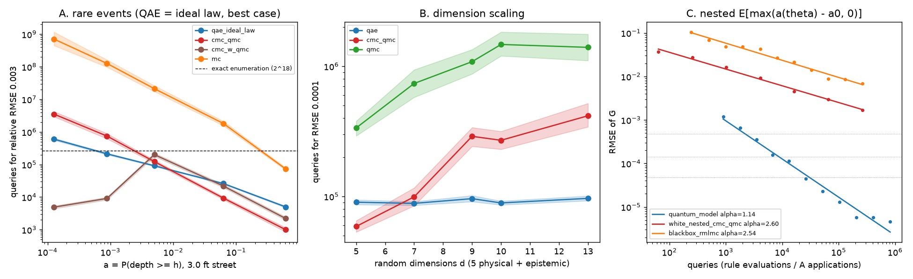

# Floodline: is there any honest axis where QAE beats the best classical method?

`experiment_wins.py` tests three axes the earlier studies did not: rare events, dimension and
nested expectations. `check_wins_cv.py` adds one skeptic check. Accounting is the same as in
`experiment_multi.py`. One query is one flood-rule evaluation at one driver vector, or one
application of A or A†. Conditional arms count one query per sample (white-box); a black-box
simulator would pay about 6 per sample. QAE is ideal and fault-free: hit probabilities come from
the closed form sin²((2m+1)θ). Every arm uses 64 replicates, an OLS fit of log RMSE on log
queries and 2000 bootstrap resamples. A ratio whose 95% CI contains 1 is a tie. Ratios are
classical queries ÷ QAE queries, so a ratio above 1 means QAE needs fewer.

Smallest resolvable ratio, stated before the runs: about ±10-15% (the CI half-widths of the
prior study). Cells below that are reported as ties.

## Verdict

| axis | best classical tried | result (classical ÷ QAE queries, 95% CI) | verdict |
|---|---|---|---|
| **B. dimension**: 5 physical drivers + up to 8 epistemic parameters | CMC+QMC (P3 exact) | d=5: 0.65 [0.58, 0.73]; d=7: 1.12 [0.96, 1.32]; d=9: 3.0 [2.5, 3.6]; d=10: 3.0 [2.6, 3.6]; **d=13: 4.3 [3.5, 5.4]** at ε=1e-4. At ε=3e-4, d=13: 2.1 [1.8, 2.4]. At ε=1e-3: ties or losses at every d | **QAE wins in query count from d≈7-8 at ε≤3e-4** |
| A. rare events (relative error), P(depth ≥ h) at a 3 ft street | best of CMC over rain, CMC over tide, enumeration (2^18) | h=0.5-1 ft: 0.14-0.55 (loss). h=3-5 ft: tide-CMC needs **0.007-0.06×** QAE's queries (crushing loss). h=2 ft (a=5e-3), rel 3e-3: 1.34 [1.19, 1.51] over rain-CMC, but only under the ideal QAE law, and enumeration is within 2.9× | loss, with one narrow, assumption-dependent window |
| C. nested E_θ[max(a(θ) - a0, 0)] under GEV uncertainty | nested CMC+QMC; randomized MLMC | quantum best-case model α=1.14 vs classical α≈2.6. Classical arms extrapolated 30-10⁴× past the data | not defensible as measured; theory-backed candidate only |
| vector outputs, memory | analysis only | one classical sample gives every street's answer (the rule is monotone in elevation); enumeration streams in O(chunk) memory | loss, not run |

**Best honest headline:** *Once the model's own parameter uncertainty is integrated in (8
epistemic inputs the Stormwater Master Plan and the NOAA tide fit leave uncertain, 13 random
dimensions in all), ideal QAE needs 4.3× [3.5, 5.4] fewer oracle queries than the best
classical estimator we know (conditional MC on Sobol points) at ε = 1e-4. Its exponent stays at
1.0 while the classical one climbs from 1.31 to 1.68. The crossover sits at d ≈ 7-8.* This is
a query-count result. The caveats below decide whether it means anything in wall-clock time.

## B. Dimension: the win

Drivers: W, P24, P3, S, O as before. Added in this order:

| added | parameter | range | source |
|---|---|---|---|
| d=7 | curve number CN, soil depth | U(88, 95), U(3, 5) ft | SMP Table 2-6 range; SMP "3 to 5 feet" |
| d=9 | outfall share, catchment ratio | U(0.25, 0.75), U(2, 4) | ASSUMPTION ranges around the code's 0.5 and 3 |
| d=10 | gravity-well start | U(1.4, 1.8) ft | ASSUMPTION, ±0.2 ft around the SMP's 1.6 |
| d=13 | tide-GEV (shape, loc, scale) | normal approx. of a 200-refit parametric bootstrap | NOAA 8724580, 110 years |

Drainage is recalibrated from the same 5-yr LOS anchor for every sample. The rule runs in
floating point on the benchmark driver grid, so a(d=5) = 0.6430 here against 0.6148 with the
integer tables. Truth for each d comes from an independent 32 × 2^21 CMC+QMC run (SE ≤ 6e-6,
under 6% of the tightest ε).

| d | a | α QAE | α CMC+QMC | α QMC | queries at ε=1e-4: QAE / CMC+QMC / QMC |
|---|---|---|---|---|---|
| 5 | 0.6430 | 0.97 | 1.31 [1.26, 1.36] | 1.43 | 90k / 59k / 336k |
| 7 | 0.6447 | 0.99 | 1.52 [1.44, 1.61] | 1.69 | 88k / 99k / 737k |
| 9 | 0.6098 | 1.01 | 1.64 [1.57, 1.72] | 1.60 | 96k / 289k / 1.08M* |
| 10 | 0.6095 | 1.00 | 1.62 [1.54, 1.71] | 1.76 | 89k / 270k / 1.47M* |
| 13 | 0.6106 | 1.01 | 1.68 [1.59, 1.78] | 1.68 | 97k / 416k / 1.40M* |

\* extrapolated past 2^20. No CMC+QMC cell is extrapolated.

The skeptic's next move is a control variate: the same conditional integrand at the nominal
parameters on the same Sobol point, whose mean is known. It does not help (`check_wins_cv.py`,
d=13, 24 scrambles). RMSE is 1.21e-4 plain vs 1.18e-4 with the CV at N = 2^18, and the CV costs
2 queries per sample. Exact enumeration is no longer an option either: the epistemic inputs
are continuous, and enumerating the 2^18-cell base grid for every outer parameter point costs
at least 2.6e5 × (number of outer points).

**Why it holds.** The epistemic inputs move the drainage threshold, and the flood boundary moves
with them. The conditional integrand stays discontinuous in 12 dimensions, and Sobol's rate
falls towards the He-Owen 2d/(d+1) limit. MLAE's rate does not depend on d.

**Caveats that decide whether this matters:**
1. **Query count only.** The d=5 A is already 149k CX through QROM tables. Folding 8 more
   continuous parameters into the tables would multiply their address space by roughly 2^32.
   This only works with a coherent arithmetic oracle (SCS runoff, sqrt, calibration), which
   nobody has built (`README_multidriver.md` limitation 4). Per query, classical is about
   100 flops.
2. Three of the eight ranges (outfall share, catchment ratio, well start) are judgment calls,
   and the crossover depends on them.
3. ε = 1e-4 is far tighter than the model uncertainty (the GEV bootstrap alone spreads a by
   about ±0.016). At ε = 1e-3 this is a tie or a loss at every d.
4. Black-box counting (6 rule runs per conditional sample) would multiply the classical
   column by 6. White-box is the conservative choice for quantum.

## A. Rare events: loss

P(water depth ≥ h at a 3.0 ft street, 2050). Only the tolerance changes (drainage stays
calibrated at 0.5 ft). h = 0.5 / 1 / 2 / 3 / 5 ft gives a = 0.61 / 0.063 / 5.0e-3 / 8.8e-4 /
1.3e-4. Targets are relative RMSE 1e-2 / 3e-3 / 1e-3.

Two things the first pass got wrong are fixed in `axis_rare2`:
- **MLAE with 100 shots per power breaks for a < 1e-2.** Its RMSE stalls past about 2e5
  queries, because it locks onto the wrong fringe. At h = 5 ft it would need 7e8 queries at
  3e-3. Reporting that would hand classical a fake win. QAE gets its best case instead: the
  ideal law, queries ∝ sqrt(a(1-a))/ε, with the constant from the MLAE fit at a = 0.61. This
  is the same convention as `floodline_cli.qae_line`.
- **The deep tail is driven by the tide, not by rain.** Tide alone accounts for 69% of a at
  h = 5 ft. So the skeptic integrates the tide exactly (`cmc_w`, unbiased to 1e-4 relative
  against enumeration), not the rain burst.

| h (a) | QAE ideal, rel 3e-3 | rain-CMC+QMC | tide-CMC+QMC | enumeration | best classical ÷ QAE |
|---|---|---|---|---|---|
| 0.5 (0.61) | 5.0k | 1.0k | 2.2k | 262k | 0.20 [0.17, 0.24] |
| 1 (0.063) | 26k | 9.3k | 22k | 262k | 0.36 [0.32, 0.40] |
| 2 (5.0e-3) | 91k | 123k | 201k | 262k | **1.34 [1.19, 1.51]** |
| 3 (8.8e-4) | 212k | 746k | 9.1k | 262k | 0.043 [0.038, 0.048] |
| 5 (1.3e-4) | 599k | 3.5M* | 4.9k | 262k | 0.008 [0.007, 0.009] |

The h = 2 ft cell is the mixed tide/rain regime, where neither one-dimensional conditioning
removes most of the variance. QAE leads by 1.34× at relative 3e-3 and 1.89× [1.62, 2.21] at
1e-3, but enumeration (2.6e5) beats it at 1e-3 and the lead rests on the ideal QAE law. The
MLAE we actually simulated needs 3.7e5 there. A skeptic who stratifies by regime (tide-CMC
where the tide dominates, rain-CMC elsewhere) was not tried and would probably close it.
Importance sampling plus CMC on Sobol was tried and is worse than plain CMC+QMC at every
depth (exponential tilt; its weights blow up in the tail). It is in the JSON.

## C. Nested expectation: not a measured win

G = E_θ[max(a(θ) - a0, 0)] over the tide-GEV bootstrap θ, with a0 = a at the fitted θ = 0.6430.
G = 0.00478 ± 6e-5 (reference: 4 × 256 outer Sobol θ × 2^14 inner CMC+QMC). The targets are
10%, 3% and 1% of G.
- Nested CMC+QMC (outer Sobol over θ, inner CMC+QMC, N_in = N_out): α = 2.6 [2.3, 3.1].
- Black-box randomized MLMC (single-term, antithetic, inner indicator draws): α = 2.5 [2.2, 2.9].
- Quantum: a cost MODEL. MLAE on an amplitude equal to G, which is the best case for the
  nested algorithms of arXiv:2602.08120 and 2502.05094 (their polylog factors are ignored).
  α = 1.14.

The model puts quantum 3e3-1e5× ahead, but every classical number is extrapolated 30× to 10⁴×
past the largest budget run (RMSE at 2.6e5 queries is still 1.7e-3, against ε = 4.8e-5). The
classical designs were not tuned either: the inner/outer split was balanced, and there is no
surrogate for the smooth 3-D a(θ). A surrogate would cost about (tens of θ points) × (inner
cost) and fall well below the fitted line. The direction agrees with the theory (Õ(1/ε) against
Õ(1/ε²) when g is nonlinear and the inner expectation is only samplable). The measured result is
not defensible as a pitch number. Further caveat: the reference SE (6e-5) exceeds the 1% target
(4.8e-5), so the tightest column is reference-limited.

## Run

```
uv run python experiment_wins.py rare dim nested   # ~38 min on 6 cores
uv run python experiment_wins.py rare2             # ~12 min, needs the rare results
uv run python check_wins_cv.py 2                   # ~5 min
```

Outputs: `results_wins.json` (every fit, CI and ratio) and `results_wins.png` (A: queries vs a
at relative 3e-3; B: queries vs d at ε=1e-4; C: RMSE vs queries for G). One manual step: the
`rare2` results in the JSON were re-keyed after the run (the `queries_ci` and `extrapolated` keys
of `qae_ideal_law` from absolute to relative ε, in order). The code now does this itself.


